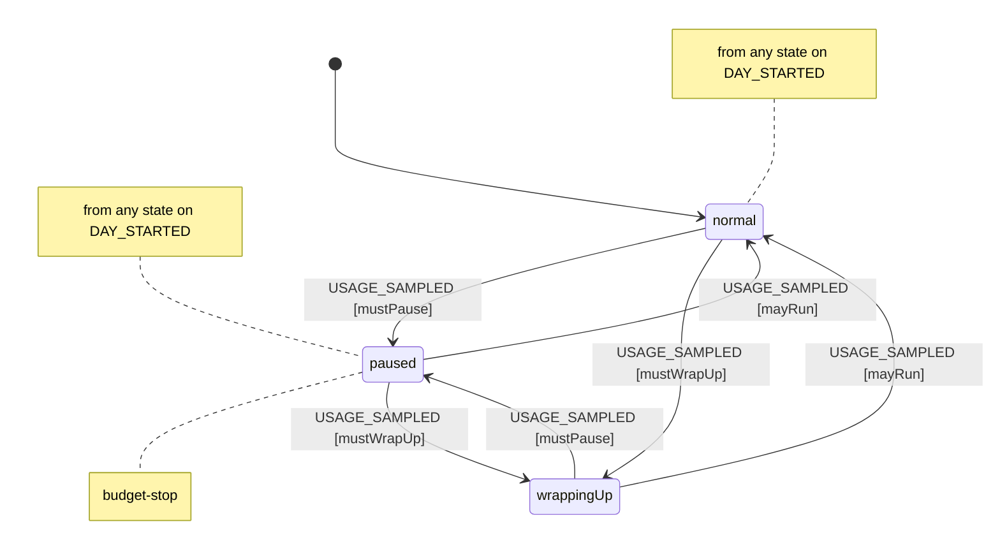
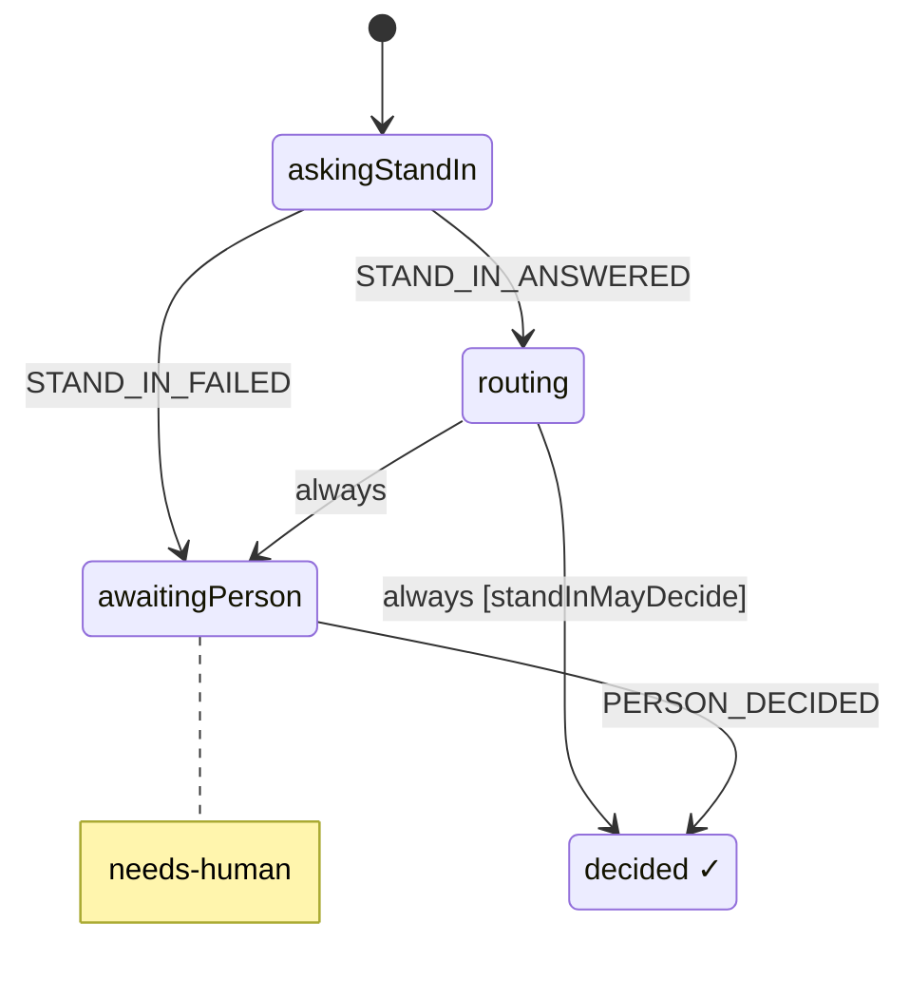
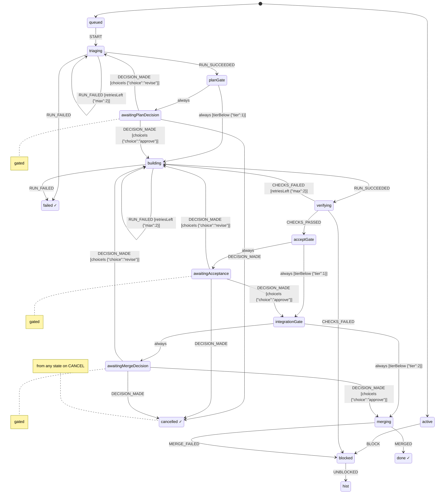
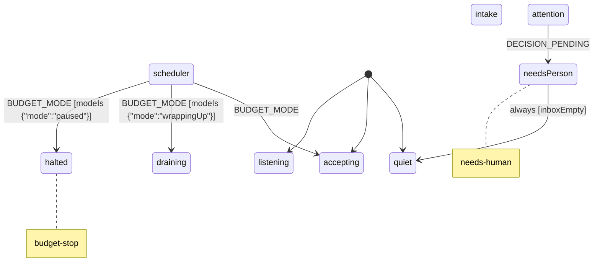

# Harness spec (generated)

Generated from `packages/harness/spec/*.machine.json` by `npm run spec:render`. Do not edit by hand: change the JSON.

## budget (v0.1.0)

Spends a daily slice of the person's 7-day Claude usage window and watches the 5-hour window. Utilization values are 0..1 shares of each window.

Effects and context updates: `applyConfig`, `recordUsage`, `reportMode`, `startDay`

Guards: `fiveHourExhausted`, `mayRun`, `mustPause`, `mustWrapUp`

## decision (v0.1.0)

One decision. The stand-in answers first; it decides alone only where its autonomy for this decision class is earned, otherwise the person decides on a card with its recommendation.

Effects and context updates: `acceptStandInChoice`, `askStandIn`, `logPrecedent`, `notifyInboxClosed`, `notifyInboxOpened`, `postDecisionCard`, `recordPersonChoice`, `recordStandInAnswer`, `reportDecision`

Guards: `standInMayDecide`

## workItem (v0.1.0)

One thing moving through the pipeline: a change to one project of the monorepo, from request to merge. Runs and merges happen outside the machine; their results come back as events on later wakes.

Effects and context updates: `checkpoint`, `countRetry`, `dispatchRun`, `mergePullRequest`, `openDecision`, `recordChoice`, `recordRun`, `reportBlocked`, `reportFinished`, `withdrawDecision`

Guards: `choiceIs`, `retriesLeft`, `tierBelow`

## harness (v0.1.0)

The root actor, held by the orchestrator thread. Takes requests, keeps 2-4 items in flight within budget, and keeps the person's inbox.

Effects and context updates: `addToInbox`, `publishDigest`, `recordBudgetMode`, `releaseSlot`, `removeFromInbox`, `spawnWorkItem`, `startReadyItems`, `wrapUpInFlight`

Guards: `inboxEmpty`, `modeIs`
